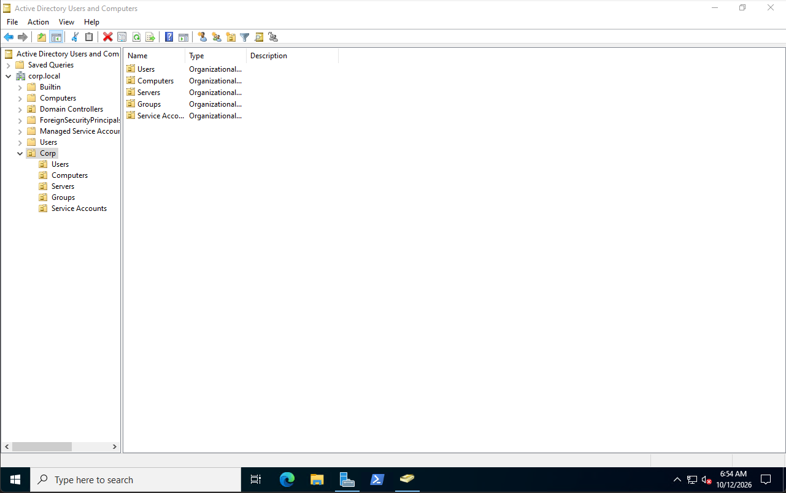
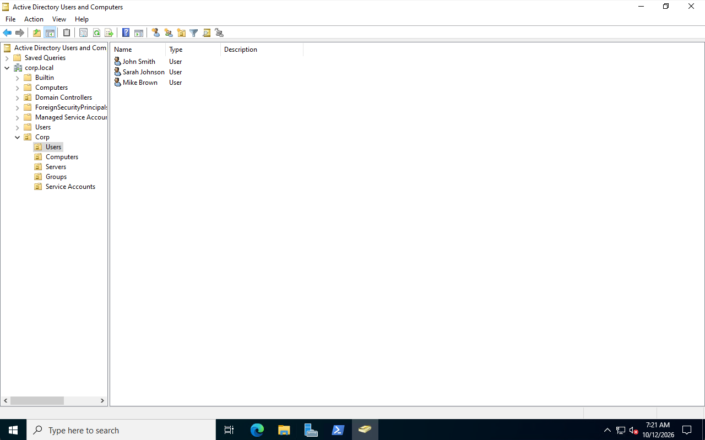

# Active Directory Setup

## Objective
Configure Active Directory Domain Services (AD DS) on DC1 to manage domain users, computers, and security groups in the enterprise lab.

## Environment
| Component | Details |
|---|---|
| Domain Controller | DC1 |
| OS | Windows Server 2022 Standard Evaluation |
| Domain | corp.local |
| IP Address | 192.168.1.251 |
| DNS | 127.0.0.1 |
| AD DS | Installed |

## Steps

### 1. AD DS Installation
- Installed the Active Directory Domain Services role through Server Manager
- Promoted DC1 to a domain controller
- Created a new forest named corp.local
- Restarted DC1 after promotion

### 2. DNS Configuration
- Confirmed DNS was installed with AD DS
- Configured DC1 to use 127.0.0.1 for DNS
- Verified the domain was resolving correctly

### 3. Organizational Unit Structure
- Opened Active Directory Users and Computers
- Created a parent OU named Corp
- Created five child OUs: Users, Computers, Servers, Groups, and Service Accounts
- Enabled accidental deletion protection for the OUs
- Verified the OU structure in Active Directory Users and Computers

### 4. User Account Management
- Created three test domain users in the Users OU using Active Directory Users and Computers
- Configured usernames and temporary passwords
- Required users to change their passwords at first login
- Verified the accounts were created successfully

### 5. Security Groups
- Created two global security groups: GG-IT and GG-HR
- Added John Smith and Mike Brown to GG-IT
- Added Sarah Johnson to GG-HR
- Verified group membership using Active Directory Users and Computers

### 6. PowerShell Administration
- Used Get-ADUser to list domain user accounts
- Used Get-ADGroup and Get-ADGroupMember to verify security groups and membership
- Practiced removing and adding users to security groups with PowerShell
- Created an AD user audit script to display account information
- Saved the script in the powershell folder for reuse
