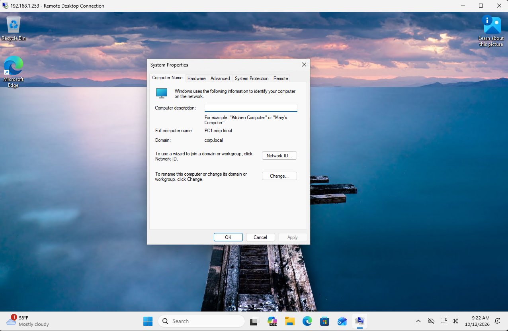

# Windows 11 Domain Join

## Objective
Configure a Windows 11 Pro workstation and join it to the corp.local Active Directory domain.

## Environment
| Component | Details |
|---|---|
| Workstation | PC1 |
| OS | Windows 11 Pro |
| Hypervisor | UnRAID KVM/QEMU |
| IP Address | 192.168.1.253 |
| DNS Server | 192.168.1.251 |
| Domain | corp.local |

## Steps

### 1. Windows 11 VM Setup
- Created PC1 in UnRAID with 2 vCPUs, 6 GB RAM, and a 64 GB virtual disk
- Installed Windows 11 Pro using the Microsoft ISO
- Installed VirtIO drivers and QEMU Guest Agent

### 2. Network Configuration
- Configured PC1 with a static IP address of 192.168.1.253
- Set the preferred DNS server to DC1 at 192.168.1.251
- Verified connectivity and domain DNS resolution using PowerShell
- Enabled Remote Desktop to manage PC1 from the admin workstation

### 3. Active Directory Domain Join
- Joined PC1 to the corp.local domain using domain administrator credentials
- Restarted PC1 to complete the domain join
- Signed in using the CORP\jsmith domain account
- Verified domain membership using PowerShell

### 4. Active Directory Computer Management
- Located PC1 in the default Computers container
- Moved PC1 into the custom Corp/Computers OU
- Verified PC1 was listed in the correct OU
