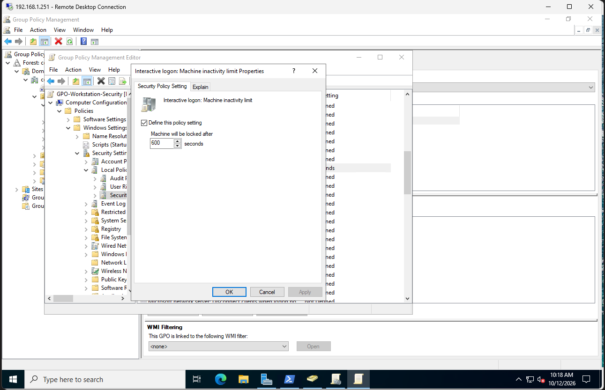
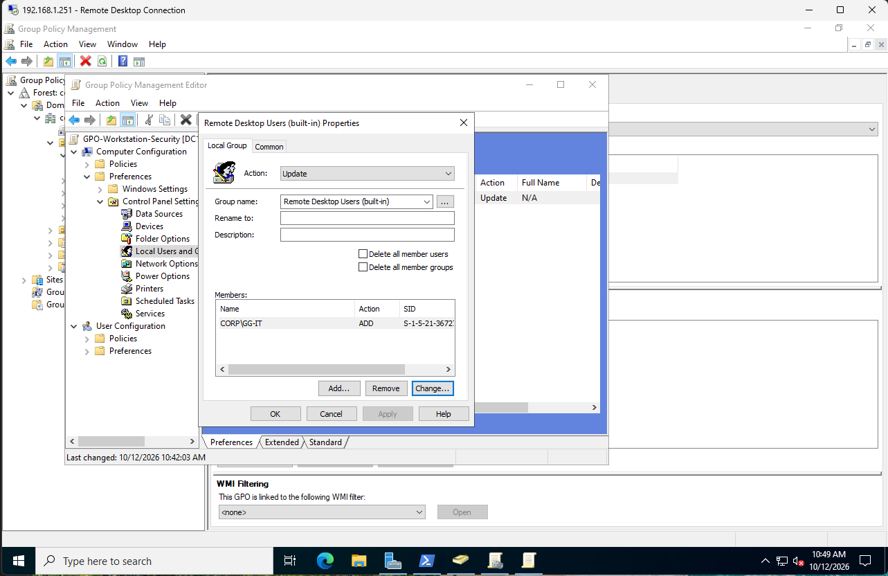

# Group Policy Management

## Objective
Configure and manage Group Policy Objects (GPOs) in Active Directory to apply security settings to domain-joined workstations.

## Environment
| Component | Details |
|---|---|
| Domain Controller | DC1 |
| Workstation | PC1 |
| Domain | corp.local |
| Target OU | Corp/Computers |
| GPO | GPO-Workstation-Security |

## Steps

### 1. Workstation Security GPO
- Opened Group Policy Management on DC1
- Created a new GPO named GPO-Workstation-Security
- Linked the GPO to the Computers OU under Corp
- Configured the machine inactivity limit to 600 seconds (10 minutes)



### 2. Group Policy Application and Verification
- Ran gpupdate /force on PC1 to apply the updated policies
- Used gpresult to confirm the workstation security GPO was applied
- Verified the inactivity timeout value using PowerShell
- Tested the automatic screen lock on PC1

### 3. PowerShell GPO Management
- Used Get-GPO to view the domain's Group Policy Objects
- Used Get-GPInheritance to inspect policy links on the Computers OU
- Verified the workstation security policy was linked to the correct OU

### 4. Domain Password Policy
- Opened the Default Domain Policy in Group Policy Management
- Set the minimum password length to 12 characters
- Enabled password complexity requirements
- Configured password history and password expiration settings
- Verified the domain password policy using PowerShell

### 5. Account Lockout Policy
- Configured the account lockout threshold to 10 failed attempts
- Set the lockout duration to 15 minutes
- Set the lockout counter to reset after 15 minutes
- Used Get-ADDefaultDomainPasswordPolicy to verify the settings

### 6. Remote Desktop Access Management
- Used the existing GG-IT security group to manage RDP access
- Configured Group Policy Preferences to add GG-IT to the local Remote Desktop Users group
- Applied the GPO to the Computers OU so it can manage future domain workstations
- Removed the individual RDP permissions previously configured on PC1
- Verified the local group membership using PowerShell
- Confirmed that IT users could connect through RDP while the HR test user was denied access



## Troubleshooting

### Group Policy Not Applying
- After creating the workstation security GPO, PC1 was not receiving the policy
- Ran `gpupdate /force`, but the computer policy update timed out
- Checked domain connectivity using `nltest` and verified access to SYSVOL on DC1
- Found that accessing SYSVOL with the local admin account failed, while the domain account could access it
- Used `Test-ComputerSecureChannel -Verbose` and found that PC1's domain trust was broken
- Repaired the secure channel using domain administrator credentials:

```powershell
Test-ComputerSecureChannel -Repair -Credential (Get-Credential) -Verbose
```

- Verified the secure channel was working and confirmed the GPO applied successfully

The exact cause of the broken trust was not determined, but repairing the secure channel resolved the Group Policy issue.